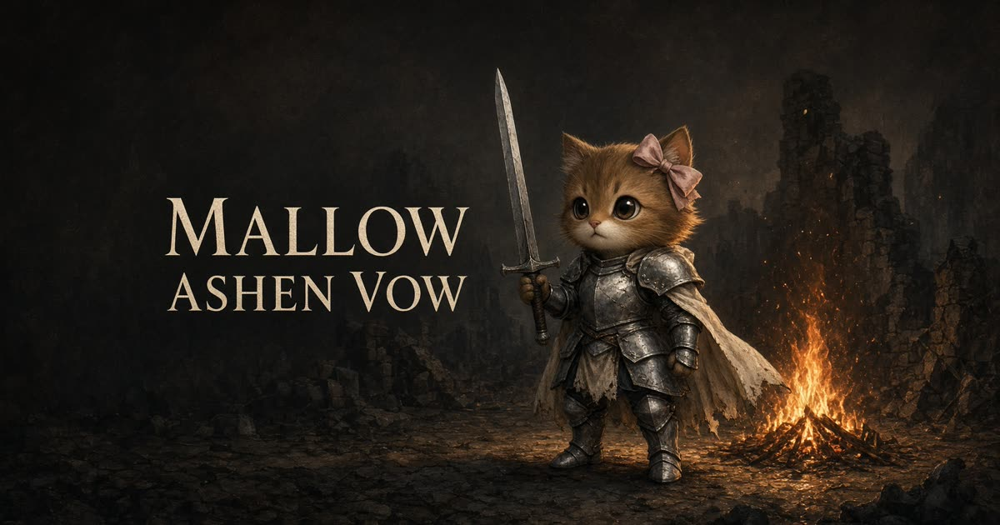
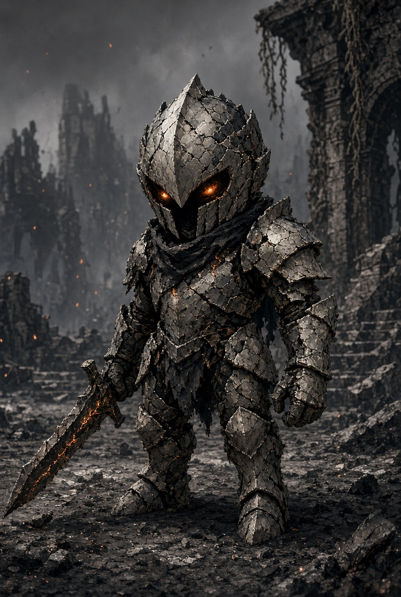
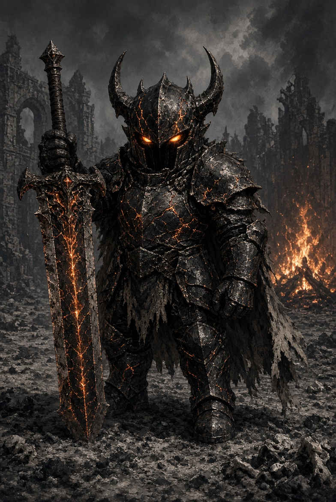
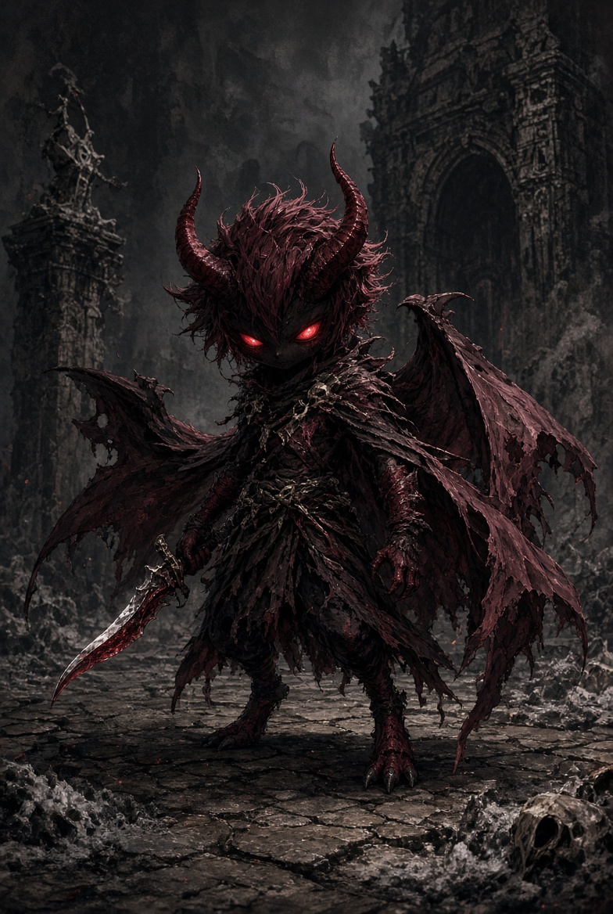

# Mallow: Ashen Vow 粉誓

試玩：[https://mallow-ashen-vow.grok.me/](https://mallow-ashen-vow.grok.me/)



橫幅圖是 `public/x-banner.jpg`。概念圖：

| 灰殼 | 煤灰公爵 | 紅契 |
| --- | --- | --- |
|  |  |  |

## 現在給同事（2026-10-12）

目前進度在 `main`。版本 **0.5.1**，標題畫面也會顯示。公開試玩網址是 [mallow-ashen-vow.grok.me](https://mallow-ashen-vow.grok.me/)。新功能仍建議開分支再開 PR。

- 戰鬥數字：`src/game/moves.ts`
- 鏡頭：`src/game/camera.ts`
- 公爵選招：`src/game/foes.ts`
- 玩家動作、無敵、收刀：`src/game/player.ts`
- 敵人外形：`src/game/enemyMesh.ts`
- 模擬：`src/game/createGame.ts`
- 畫面：`src/routes/index.tsx`

電腦按 E 食水回血，R 已取消。出刀前搖有橘色環，重擊環較大。翻滾無敵有淡白環，收刀期間有粉紅環。普通玩家介面不顯示血量數字、撿灰 +數字、倒下次數和本局時間。撿灰有餘燼、擴環和短音。看不懂公爵哪招，只改 `MOVE.duke`。


瀏覽器類魂垂直切片。玩家是 Sir Mallow，一隻戴粉紅蝴蝶結、穿銀甲、劍有點太大的騎士貓。

這是 **Three.js** 網頁遊戲，不是 Unity 專案。值得測的是戰鬥：鎖定、翻滾無敵、體力、格擋、架勢、暖瓶、火芯。

## 現在進度（2026-10-10，下午）

可玩的一場庭院已經在 `main`。

- 路中灰殼瘦、劍短、有兜帽，沒有盾。側翼灰殼寬、有盾。公爵更高，有角和面罩。紅契有角和翅。外形在 `src/game/enemyMesh.ts`。敵人不再用騎士貓的耳、鼻和尾巴，底模改在 `src/game/knightMesh.ts`。
- 三隻灰殼倒下後拱門打開，煤灰公爵醒來。
- 公爵四招：橫斬、舉劍重擊、震地、低頭衝鋒。半血進入第二階段。衝鋒收招在二階段較長，留給懲罰。
- 重擊和成功格擋會累敵人架勢。架勢崩了會硬直約 1 秒，並多吃一段傷害。
- 翻滾跟輸入方向；沒有輸入才朝角色背後滾。
- 架勢條、收招「可打」和骨白圈、格擋白弧、鏡頭拆到 `camera.ts` 已在 `main`。公爵衝鋒和橫斬前搖已再拉長。
- 被打時鏡頭會被撞開、視野一瞬變寬，並往攻擊來的方向傾。格擋成功只會輕撞一下。
- 鏡頭跟手有一點延遲。揮刀會推近，打中會再縮一下視野並輕微晃動，鎖定時人和目標會同時留在畫面裡。
- 鎖定目標頭上有粉紅菱形，切換時會滑過去。收招或硬直時鎖定名會顯示「可打」，地面圈會隨收招縮小。
- 路中灰殼倒下、且離開火芯一段距離之後，線上惡魔紅契才可能侵入。公爵已醒來時不侵入。
- 第一下打中會打開刀聲。
- 角色和場景仍是程序化建模。騎士貓有腿甲、臂甲、護手和拇指、兩片斗篷、較長的劍。敵人現在有專屬程序化模型（`src/game/enemyMesh.ts`）：灰殼有裂痕甲和短劍、公爵有角盔與發光裂縫、紅契有小翼與紅刃。概念圖放在 `public/concepts/`。火芯是石圈、炭和火簇。拱門有裂縫，打開時布會落下。地面有從火芯到拱門的踏痕。沒有用 Hero Forge 或其他人的模型檔。
- 場景氛圍參考雲海和光塵：庭院有暖霧、緩慢漂浮的光點，以及兩道很淡的光柱。不是複製別人的 shader。
- 粒子用 `THREE.Points`：鋼色是打中，粉色是重擊和架勢崩壞，灰塵是翻滾和震地，灰焰是死亡與撿灰，紅焰是紅契侵入。震地另有一圈向外擴的塵環。
PayMe 贊助文案在標題、Esc 選單和通關畫面。
- 打中有刀光、火花、短暫停頓和金屬加噪聲。格擋和架勢崩解也有獨立音效。
- 死亡掉灰，走回去撿。火芯回血、回瓶。200 灰可鍛誓 +12 生命，上限 180。

## 操作

- **WASD** 相機相對移動。右鍵拖曳轉鏡頭。
- **Shift** 跑步，吃體力。
- **左鍵** 或 **J**：輕擊。**右鍵** 或 **K**：重擊。前搖有橘色環，收刀有粉紅環。這一刀要完全結束，才能再出下一刀。中鍵或觸控拖曳轉鏡頭。
- **按住 C** 格擋。腳下會出現朝前的白弧，體力低時弧會變淡。體力空了會破防。
- **Space** 翻滾。有方向就朝方向滾，約 0.04–0.34 秒無敵，腳下會有一圈淡白環。出刀後的收刀期間有粉紅環，這時不能再出下一刀。
- **Q** 鎖定，再按切下一個近處目標。
- **E** 食水回血。**G** 在火芯歇息。**F** 在火芯花 200 灰鍛誓。
- **Esc** 選單。手機用左搖桿和右側按鈕。

## 版本規則（必須遵守）

任何 PR 或直接合併到 `main` 時，**必須更新版本號**。

版本規則參考 [Software versioning](https://en.wikipedia.org/wiki/Software_versioning)（Semantic Versioning 精神）：

- 版本定義在 `src/game/version.ts`：
  ```ts
  export const GAME_VERSION = "0.5.1";
  ```
- 標題畫面會顯示這個版本。
- 規則（MAJOR.MINOR.PATCH）：
  - **PATCH**（`x.y.Z`）：向後相容的修正、小調整、文件／模型替換等
  - **MINOR**（`x.Y.0`）：向後相容的新功能、明顯外觀或戰鬥改動
  - **MAJOR**（`X.0.0`）：不相容的大改動
- PR 描述或 commit message 請註明版本變更。
- CI 會檢查版本檔案存在，但不會自動遞增——請手動更新。

## 分支

不要直接推 `main`。新功能開分支，開 PR，確認後再合併。合併前必須更新 `src/game/version.ts`。

## 同事接手

戰鬥模擬還在 `src/game/createGame.ts`。招式數字在 `src/game/moves.ts`。鏡頭在 `src/game/camera.ts`。公爵選招和收招長度在 `src/game/foes.ts`。玩家動作結束和翻滾無敵在 `src/game/player.ts`。HUD 型別在 `src/game/hud.ts`。畫面和 PayMe 在 `src/routes/index.tsx`。角色網格在 `src/game/knightMesh.ts`、`src/game/mallowRig.ts` 和敵人專屬 `src/game/enemyMesh.ts`。

先不要加地圖或第二個主角。粉紅蝴蝶結和太大的劍就是識別。

下一刀照下面的 **Planning** 做。先做介面手感，再雕模型和場景。不要加地圖或第二主角。

1. 自己連續打公爵五次。若有一次不知道死在哪招，就把那招的前搖再拉長，不要加新敵人。
2. 招式數字已抽到 `src/game/moves.ts`。模擬仍在 `createGame.ts`。再拆時才分玩家、敵人、鏡頭。
3. 音效仍是 WebAudio 合成。第一刀會自動開聲，標題的靜音按鈕仍可用。


## 隱藏測試通道

平常玩家看不到。電腦在遊戲頁面鍵盤輸入 `vowdebug`（不用按 Enter），再打一次就關閉。手機在戰鬥中按鎖定 6 下、翻滾 1 下、再按鎖定 3 下，會開關自動測試。左下角會出現「QA · 騎士貓自動」。

- **自動**：騎士貓自己鎖定、走近、前搖翻滾、收招出刀、血少喝瓶。死了會從火芯再起，通關會再走一次。
- **循環**：開 AI 對 AI harness，並用**學習玩家政策**（tabular ε-greedy）代替靜態 autoThink。每場勝／敗會記下來，用 CombatFeel（hit／heavy／stance-break／stamina／hurt／block）同終局結果更新 Q 表。狀態寫在 `sessionStorage` 的 `mallow-qa-harness`；政策寫在 `mallow-qa-learner`。
- **再起**：手動從火芯或標題開始。
- **關**：關掉面板。同一分頁重新整理還在，按關才清掉。

瀏覽器 console 也可控：

```js
window.__controlsTest.setAuto(true)
window.__controlsTest.setHarness(true)
window.__controlsTest.harness()      // { wins, losses, feelTotals, recentRuns, ... }
window.__controlsTest.learner()      // { wins, losses, epsilon, qStates, topPrefs, ... }
window.__controlsTest.resetLearner() // 清 Q 表／勝敗（會重新種 dodge／punish prior）
window.__controlsTest.feelCounts()   // 本局 feel 計數
window.__controlsTest.feelRecent()   // 最近 feel 事件
```

CombatFeel 只係適配層：喺現有 FX 呼叫旁 emit，**唔改** `moves.ts`／Graphics 手感數值。模組喺 `src/game/combatFeel.ts`，自動決策喺 `src/game/autoHarness.ts`，學習政策喺 `src/game/playerLearner.ts`。`stance-break.amount` = 觸發崩架嘅 poise 傷害（統一語意）。

這只用於除錯，不要放到標題畫面。

## 本地跑

```bash
npm install
npm run dev
```

打開終端印出的本地位址。需要 WebGL。

## Planning

更新日期：2026-10-14。同事照這個順序做。先不要加新地圖、新主角、武器樹。

### 介面與畫面效果

第一輪進度：

1. **傷害數字。** 曾做，現已對普通玩家隱藏。
2. **氣力條。** 已做。消耗時閃一下，太低時邊框變灰。
3. **前搖提示。** 已做。頭上有顏色條，地面圈還在。
4. **受擊介面。** 已做。吃傷紅邊，格擋白邊。
5. **鎖定。** 已做。頭上粉紅菱形，切換時滑過去。

第二輪進度：

6. 暖瓶空了變暗。已做。撿灰不顯示數字，改成餘燼、擴環和短音。
7. 公爵第二階段血條變紅，並打「第二階段」橫幅。已做。
8. 手機斬和重分開。滾和鎖加大。已做。自動測試手勢仍不在按鈕上。
9. 倒下先黑屏再出字。通關先留約 1.6 秒再出結算。已做。

### 3D 模型（0.6.0 Phase）

#### 已完成 ✅
- **騎士貓頭身比例**：`1.08,0.92,0.84` → `1.15,0.88,0.82`
- **劍長度**：blade `1.48` → `1.58`，fuller `1.12` → `1.22`，tip `0.2` → `0.22`
- **手部 redesign**：簡單護手+拇指（代替兩個球）
- **公爵模型**：加高 + 肩甲加大 20% + 發光材質
- **灰殼區分**：路中（瘦+短武器）vs 側翼（寬+有盾）
- **紅契**：瘦紅配色 + 尖角披風
- **場景全部**：火芯（石圈/炭/三層火焰動畫）、拱門（裂縫/布落下動畫）、地面踏痕、餘燼/光塵粒子

### 0.7.0 Phase（下一步）

#### 已完成 ✅
1. **火焰動畫**：增加粒子動態效果
   - 火焰幾何分段數增加 (7→4, 6→3, 5→3)
   - 添加 DoubleSide 渲染
   - 餘燼粒子：18 → 28 (+55%)
   - 光塵粒子：72 → 96 (+33%)
   - 添加 AdditiveBlending

2. **拱門動畫**：通關後布匹物理模擬
   - 布匹落下物理模擬 (velocity + damping)
   - 裂縫擴散效果 (主裂縫 + 3分支)
   - Smoothstep 緩動函數
   - 動態旋轉和縮放

3. **公爵發光**：第二階段眼睛/胸口發光強度調整
   - 眼睛發光強度：1.0 → 1.2
   - 添加胸口發光指示器 (chestGlow)
   - 第二階段脈動效果

#### 待完成 ⏳
3. **燈光效果**：火芯光暈加強
4. **性能優化**：減少多餘 Draw Calls
5. **公爵發光**：第二階段眼睛/胸口發光強度調整
6. **灰殼盾牌**：材質優化
7. **紅契披風**：擺動效果

### 不做

- 開放世界、武器樹、第二主角。
- 線上惡魔保持稀有，不要在開場就出現。
- 不把 Hero Forge、未確認授權的 Unity Asset Store 模型放進 repo。

### 版本歷史

| 版本 | 日期 | 變更 |
|------|------|------|
| 0.5.4 | 2026-10-14 | Loading bar, routeTree gen |
| 0.6.0 | TBD | 模型優化（頭身比例、劍長度）|
